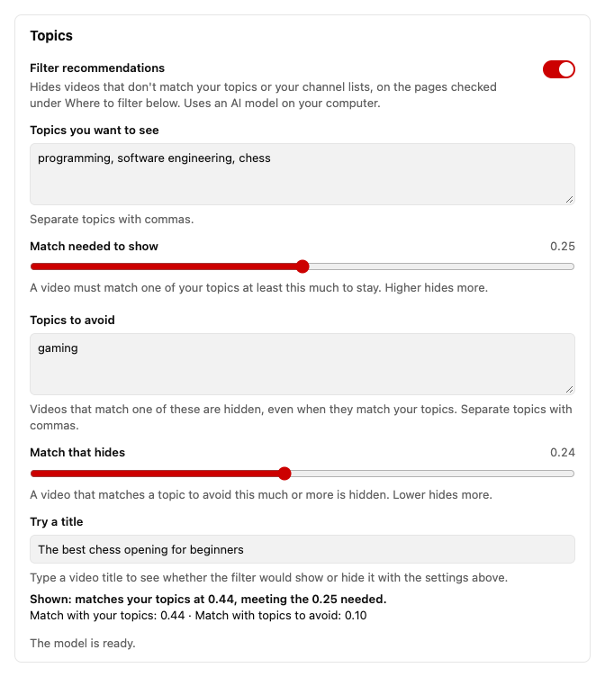

# Better YT Recommendations

**You opened YouTube to learn one thing. An hour later you're deep in cat videos and
travel vlogs.**

This Chrome extension keeps YouTube on the topics you choose:

- **Opens Your custom feed** every time you go to Home. Turn on enforcement mode to
  stay there.
- **Hides off-topic videos** next to the video you're watching and on Home. Tell it
  "programming, JavaScript, web development" and the gaming clips and talk-show
  segments disappear. It can filter Subscriptions and search results too.
- **Hides Shorts**, if you want, and opens Short links as regular videos.
- **Runs on your computer.** A small AI model compares video titles with your topics.
  Nothing you watch is sent anywhere.

> [!NOTE]
> Opening Your custom feed needs that feed to be available on your YouTube account on
> desktop.

<picture>
  <source media="(prefers-color-scheme: dark)" srcset="docs/settings-popup-dark.png">
  
</picture>

## Install

1. Open
   [Better YT Recommendations on the Chrome Web Store](https://chromewebstore.google.com/detail/better-yt-recommendations/migfjgcdmbcjeffiooeoookjjoipngaf).
2. Click **Add to Chrome**, then **Add extension**.
3. Refresh YouTube.

Chrome keeps the extension up to date for you.

> [!TIP]
> Click the puzzle icon in Chrome's toolbar and pin Better YT Recommendations, so its
> settings are one click away.

<b>Install from GitHub instead</b>

 

1. Download the zip from the
   [latest release](https://github.com/r-afael/better-yt-recommendations/releases/latest)
   and unzip it.
2. Open `chrome://extensions` in Chrome.
3. Turn on **Developer mode** in the top-right corner.
4. Click **Load unpacked** and choose the unzipped folder.
5. Refresh YouTube.

Keep the folder on your computer. To update, replace its files with a newer release,
click the extension's reload button at `chrome://extensions`, and refresh YouTube.

## How to use it

Click the extension's icon for the main switches, or **All settings** for everything
else.

- **Topics you want to see**: videos that don't match them are hidden. A few specific
  topics work better than one broad word.
- **Topics to avoid**: videos that match these more than your topics are hidden.
- **Sliders**: move them to make the filter stricter or looser. **Try a title** shows
  what the filter would do with any title.
- **Profiles**: save sets of topics, like "Work" or "Evening", and switch between them.
- **Where to filter**: pick the pages the filter works on.
- **Channels**: always show or always hide a channel. You can also right-click a video
  on YouTube to do this.
- **Keyboard shortcuts**: Alt+Shift+F turns the filter on or off, and Alt+Shift+S turns
  Hide Shorts on or off (Control instead of Alt on a Mac).

On YouTube, a row like "12 videos hidden" lets you see what was hidden. The filter only
looks at titles and channels, so it will sometimes get a video wrong.

<picture>
  <source media="(prefers-color-scheme: dark)" srcset="docs/options-page-dark.png">
  
</picture>

## Performance

The model downloads once (about 160 MB) and uses about 0.5 to 0.7 GB of memory while
it works. It is freed after 5 minutes without new videos. On a slow computer, turn off
**Filter recommendations** if it feels sluggish.

## Languages

The extension works in English, Chinese, Hindi, Spanish, Arabic, French, Bengali,
Portuguese, Russian and Indonesian. The model understands more than 100 languages, so
your topics and the videos don't need to be in the same one.

## Privacy

The extension runs only on YouTube and collects no data. The model downloads once from
Hugging Face, then runs on your computer. Read the full [privacy policy](PRIVACY.md).

## Contributing

Issues and pull requests are welcome. See [CONTRIBUTING.md](CONTRIBUTING.md), and
[src/README.md](src/README.md) for how the code is organized and how to run the checks.
Report security problems as described in [SECURITY.md](SECURITY.md).

## Credits

- [Transformers.js](https://github.com/huggingface/transformers.js) (Apache-2.0) and
  [ONNX Runtime Web](https://github.com/microsoft/onnxruntime) (MIT).
- The topic model is
  [hotchpotch/bekko-embedding-v1-a8m](https://huggingface.co/hotchpotch/bekko-embedding-v1-a8m)
  (MIT).

[MIT license](LICENSE)
