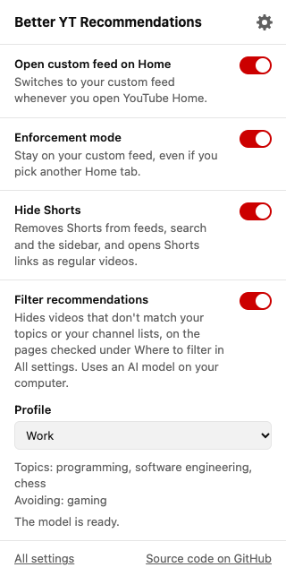

# Better YT Recommendations

**You opened YouTube to learn one thing. An hour later you're deep in cat videos and
travel vlogs.**

YouTube's recommendations are built to keep you watching, not to keep you focused.
Better YT Recommendations puts you back in control of what you see.

**Start every visit on your terms.** Set up YouTube's **Your custom feed** with the
topics you care about. The extension opens it every time you land on Home, even when
you click the YouTube logo. If you need more willpower, turn on enforcement mode and
Home stays on your feed.

**Keep the sidebar on topic.** Watching a coding tutorial? Tell the extension you
want "programming, JavaScript, web development". It hides the gaming clips,
talk-show segments and get-rich-quick videos next to it, so only recommendations
worth your time remain.

**Private by design.** A small, lightweight embedding model runs right on your
computer. The AI doesn't chat or write: it turns each video's title and
your topics into numbers that capture their meaning, then keeps the videos whose
meaning is close to your topics. The extension never sends what you watch anywhere.

*The Home feature needs **Your custom feed** to be available on your YouTube account
on desktop.*

## Settings

Click the extension's icon in the Chrome toolbar to change these. Open YouTube tabs
pick up changes right away.

- **Open custom feed on Home** (on by default): switches to Your custom feed when
  Home opens. Turn it off to stay on whichever Home tab you pick. The topic filter
  has its own toggle, below.
- **Enforcement mode** (off by default): keeps you on Your custom feed. Clicking
  another Home tab, like Podcasts or All, does nothing, and if YouTube switches tabs
  on its own, the extension switches back.
- **Hide Shorts** (off by default): hides the Shorts entry in the side menu, Shorts
  shelves on Home, Subscriptions and channel pages, and Shorts in search results and
  the sidebar. A link to a Short opens it as a regular video,
  without the endless feed of Shorts after it.
- **Filter recommendations by topic** (on by default): hides videos in the sidebar
  next to the one you're watching that don't match your topics. It does nothing
  until you type some topics. Turn it off to show every video again and free the
  model's memory.
- **Topics you want to see**: the topics to keep, separated by commas. The field is
  disabled while the filter is off.
- **Filter sensitivity** (0.25 by default): how close to your topics a video must be
  to stay visible, from 0.10 to 0.40. Move it up to hide more videos, or down if the
  filter hides videos you'd want. The sidebar updates as you move it.

The filter judges each video by its title and channel, so it makes mistakes: it may
hide a few videos you'd want, or keep a few you wouldn't. A handful of specific
topics works better than one broad word. For example, "programming, JavaScript, web
development" keeps more coding videos than "programming" alone.

While the filter is on and has topics, a line below the field shows the model's
status: waiting for you to open a video, loading, ready, or failed. Videos stay
visible while the model loads, and if it fails to load or to answer. After a
failure, it tries again a little later.



## Performance

The topic filter costs nothing until you type some topics. Then, the first time you
open a video:

- The model downloads once, about 160 MB. Chrome caches it, so later videos don't
  download it again.
- While in use, the model takes about 0.5 to 0.7 GB of memory. The extension frees it
  after 5 minutes without new videos to check, or as soon as you turn the filter off
  or clear your topics.

When most videos in the sidebar are off topic, YouTube loads more to fill it, and
the filter checks those too. On some videos, that means checking more than a
hundred videos before the sidebar settles.

On a low-end computer, checking videos may feel slow. If it does, turn off **Filter
recommendations by topic**.

## Languages

The extension recognizes the custom feed tab when YouTube is in any of the ten most
spoken languages: English, Mandarin Chinese (Simplified and Traditional), Hindi,
Spanish, Arabic, French, Bengali, Portuguese, Russian, and Indonesian. The settings
popup is translated into the same languages.

YouTube first launched the custom feed in English, so tab names in other languages
are based on YouTube's Help Center. If the extension doesn't find the tab in your
language, add the name YouTube shows to `src/labels.js` and open an issue.

The topic model understands more than 100 languages, so your topics and the video
titles don't have to be in the same language. How well it matches varies by
language.

## Setup

1. Download the zip from the
   [latest release](https://github.com/r-afael/better-yt-recommendations/releases/latest)
   and unzip it.
2. Open `chrome://extensions` in Chrome.
3. Turn on **Developer mode** in the top-right corner.
4. Click **Load unpacked** and choose the unzipped folder containing `manifest.json`.
5. Refresh YouTube. Your custom feed will open automatically.

Keep the folder on your computer. To update, replace its files with the ones from a
newer release, click the extension's reload button at `chrome://extensions`, then
refresh YouTube.

## Privacy

The extension runs only on YouTube. It doesn't track you or collect your data. It
saves your settings, including your topics, in Chrome, which syncs them across your
computers if you use Chrome sync.

The topic filter's model and its files download once from huggingface.co (Hugging
Face). After that, the model runs on your computer. The titles and channels of the
videos you see are never sent anywhere. The extension asks for the "offscreen"
permission to run the model in a hidden page of its own.

Read the full [privacy policy](PRIVACY.md).

## Development

No build step. Reload the extension at `chrome://extensions` after editing, then
refresh YouTube.

- `src/content.js` selects the tab on YouTube.
- `src/labels.js` lists the tab's name in each language.
- `src/settings.js` stores the settings for the content script and the popup.
- `src/shorts.js` hides Shorts and opens Shorts links as regular videos.
  `src/shorts.css` lists what to hide. Both load as soon as a YouTube page starts, so
  Shorts never flash on screen; the other content scripts load once the page is ready.
- `src/scheduler.js` debounces the content scripts' work after page changes.
- `src/popup.html`, `src/popup.css` and `src/popup.js` are the settings popup.
- `_locales/` has the popup's translations.
- `src/protocol.js` names the messages the extension's parts send each other.
- `src/topics.js` turns the topics field into a list of topics.
- `src/sidebar.js` finds the recommended videos on the watch page and hides or shows
  them.
- `src/topic-filter.js` decides which videos to check, asks for verdicts and applies
  them. `src/topic-filter.css` hides the off-topic videos.
- `src/background.js` opens the hidden page that runs the model, passes messages to
  it, and closes it to free memory.
- `src/offscreen.html` and `src/offscreen.js` are that hidden page. They load the
  model when needed and close it after 5 idle minutes.
- `src/matcher.js` compares video titles with your topics.
- `src/model.js` loads the model with Transformers.js.
- `src/vendor/transformers/` holds Transformers.js and ONNX Runtime Web, copied from
  `node_modules` by `scripts/vendor.js`. Don't edit these files.

To run the checks, install Node.js 24 or later and pnpm 11, then run:

```sh
pnpm install
pnpm check
```

`pnpm check` checks every script's syntax, runs ESLint (with the sonarjs rules and a
cognitive complexity of at most 10 per function), then runs the tests and fails if
coverage drops below 80%. You can also run the pieces on their own:

- `pnpm lint` runs ESLint.
- `pnpm test` runs the tests.
- `pnpm coverage` runs the tests with the coverage report.

After changing the `@huggingface/transformers` version in `package.json`, run
`pnpm install`, then `pnpm vendor` to copy the new files into `src/vendor/transformers/`.

## Contributing

Issues and pull requests are welcome. See [CONTRIBUTING.md](CONTRIBUTING.md) to get
started, and report security problems privately as described in
[SECURITY.md](SECURITY.md). Everyone taking part follows the
[code of conduct](CODE_OF_CONDUCT.md).

## Credits

- [Transformers.js](https://github.com/huggingface/transformers.js) (Apache-2.0) and
  [ONNX Runtime Web](https://github.com/microsoft/onnxruntime) (MIT) are included in
  `src/vendor/transformers/` with their licenses.
- The topic model is
  [hotchpotch/bekko-embedding-v1-a8m](https://huggingface.co/hotchpotch/bekko-embedding-v1-a8m)
  (MIT).

[MIT license](LICENSE)
